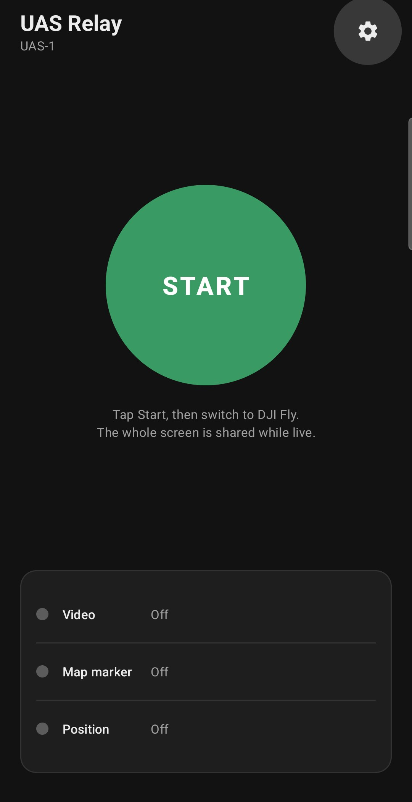
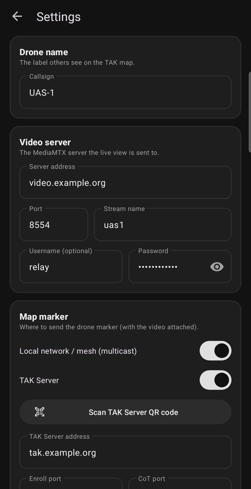
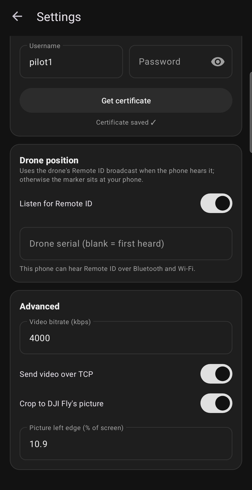

# UAS Relay

Put your drone's live video and position on the TAK map — from the phone you already fly with.

UAS Relay shares the flight app's live view (for example DJI Fly) as an RTSP stream to a
MediaMTX server, and drops a drone marker on the TAK map with that video attached. Anyone on
ATAK, WinTAK or iTAK taps the marker and watches the feed. It works with drones that have no
SDK support, like the DJI Neo, because it doesn't talk to the drone at all — it relays what's
on screen.

<p align="center">
  
  
  
</p>

## Features

- **One button.** Tap Start, switch to your flight app, fly. Stop from the app or the notification.
- **Live video to TAK.** H.264 pushed to MediaMTX over **RTSP** (TCP or UDP) or **SRT**,
  cropped to the flight app's picture so the on-screen controls aren't in the feed. SRT holds
  up better on a lossy uplink (LTE, mesh); MediaMTX re-serves it over RTSP, so the map marker
  keeps a link every TAK app plays.
- **Low bandwidth mode** for cellular: one switch (Advanced) drops the stream to 720p at
  15 fps, capped at 1.5 Mbps, still H.264 so every TAK player opens it.
- **Drone marker with the video attached.** A UAS-type CoT track carrying the stream link,
  refreshed every 2 seconds.
- **Two ways to send the marker** — use either or both:
  - **Local network / mesh** (SA multicast 239.2.3.1:6969), no server needed.
  - **TAK Server** over TLS with a client certificate. Scan your server's QR code to fill it in
    and get the certificate in one step, or enter it by hand.
  - **Channels:** choose which TAK Server channels (groups) the drone is shared to.
- **Real drone position when available.** Listens for the drone's broadcast Remote ID
  (Bluetooth and Wi-Fi). When none is heard, the marker sits at the phone's GPS position.
- **Status at a glance** for video, map marker and position.

## Requirements

- Android 13 or newer.
- A [MediaMTX](https://github.com/bluenviron/mediamtx) server reachable from the phone (and from
  the TAK users who will watch).
- For TAK Server: certificate enrollment enabled (port 8446 by default) and a user account.
  Channel selection uses the TAK Server API (port 8443).

## Install

Download the APK from [Releases](../../releases) and install it on the phone that runs your
flight app.

## Setup

1. Open **Settings** (gear icon).
2. **Drone name** — the callsign shown on the TAK map.
3. **Video server** — pick RTSP or SRT, then your MediaMTX address, port (RTSP 8554, SRT
   8890), stream name and login if it has one. SRT needs UDP 8890 open to the server.
4. **Map marker** — turn on multicast, TAK Server, or both. For TAK Server, tap
   **Scan TAK Server QR code** (ATAK enrollment or iTAK connection QR), or type the address,
   username and password and tap **Get certificate**. The password is used once to get the
   certificate and isn't saved. Optionally tap **Choose channels** and tick the channels the
   drone should appear on. Channels belong to the TAK account, so other devices signed in with
   the same login see the change — a dedicated account for the drone avoids that. Until you
   tick a channel here, the server's current channels are left as they are.
5. Go back and tap **Start**. Android asks to share the screen; choose **entire screen**.
6. Switch to your flight app and keep it on screen while you fly.

On ATAK, tap the drone marker and open its video to watch.

## Notes

- Screen sharing captures whatever is on screen. Notifications that pop up while you fly
  will show in the feed.
- Streaming over cellular? Turn on **Low bandwidth** (Advanced). Towers that can't carry
  1080p30 at 4 Mbps usually handle 720p15 at 1.5 Mbps.
- Remote ID position needs the drone to broadcast Remote ID. If the drone or region doesn't,
  the marker uses the phone's GPS.
- **Crop to DJI Fly's picture** and **Picture left edge** (Advanced) are tuned for DJI Fly on a
  Galaxy S25. Adjust the left edge for other phones, or turn cropping off for other apps.

## Building

```sh
./gradlew assembleDebug        # debug APK
./gradlew testDebugUnitTest    # unit tests
```

Release builds are signed when a `keystore.properties` (storeFile, storePassword, keyAlias,
keyPassword) is present in the project root; it is gitignored.

Built on [RootEncoder](https://github.com/pedroSG94/RootEncoder) for capture and RTSP, and
[ZXing Android Embedded](https://github.com/journeyapps/zxing-android-embedded) for QR scanning.
